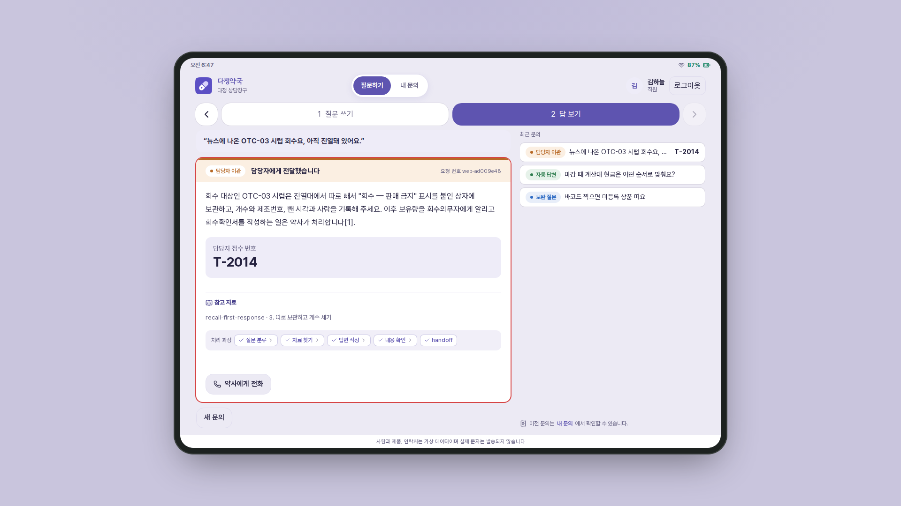
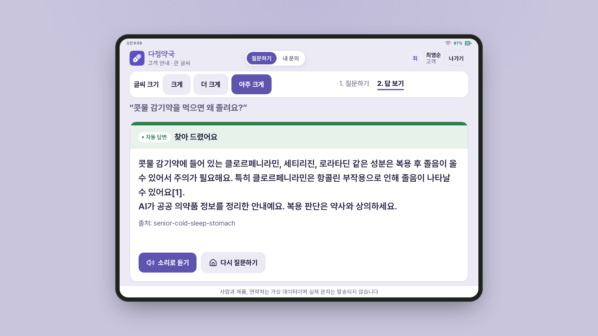
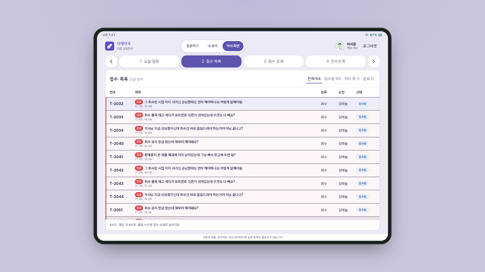

# 다정약국 · 창고형 약국 업무 도우미 (3팀)

가상 창고형 약국의 직원과 어르신 손님이 묻는 것을 n8n 워크플로우가 받아 처리하는 업무 지원 자동화입니다. **약국 문서에 근거가 있으면 바로 답하고, 사람이 정할 일은 약사 · 약국장에게 넘깁니다.** 답은 약국 문서를 먼저 검색한 뒤 그 내용으로만 쓰는 방식(RAG)으로 만듭니다.

> 엔코아 AIO 1기 단위 프로젝트 4 (2026-11-05 ~ 11-09) · 주제: 노코드 · 로코드 기반 기업형 지능형 기술 지원 자동화 (Tech Support)

| 이름 | 맡은 일 |
| --- | --- |
| **문태웅 (팀장)** | 리드 · 통합, 시험 · 품질, 실행 결과서, Jira · Slack 연동 |
| 손영민 (부팀장) | RAG (색인 · 검색), 지식 문서 검수, 최종 발표 |
| 한다영 | 오케스트레이션 (본체 워크플로우), 워크플로우 설계서 |
| 오병훈 | 연동 · 안정성 (이관 · 오류 처리), FastAPI 백엔드 |
| 차해든 | 화면 (Next.js) |

## 화면

| 직원: 회수 공지 문의 → 약사에게 긴급 이관 | 어르신: 큰 글씨 답 + 출처 + AI 고지 | 약사: 접수 목록 (긴급 먼저) |
| --- | --- | --- |
|  |  |  |

사람 · 제품 · 연락처는 모두 가짜 데이터이고, 실제 문자 · 메일은 보내지 않습니다.

## 왜 만들었나

창고형 약국은 직원이 많고 교대가 잦아서, 의약품 회수 공지 · 혼자 하는 마감 · 어르신 약 질문처럼 **"이건 내가 처리해도 되나, 약사님께 넘겨야 하나"**를 매번 사람에게 물어야 합니다. 이 도우미는 문서로 답할 수 있는 질문에는 근거와 함께 바로 답합니다. 돈 문제 · 약 판단 · 긴급 건은 반드시 약사 · 약국장에게 넘겨서, 약사는 판단에만 집중할 수 있습니다.

## 무엇을 하나

| 문의 | 누가 묻나 | 도우미가 하는 일 | 사람이 정하는 일 |
| --- | --- | --- | --- |
| 회수 공지가 떴어요 | 직원 | 회수 첫 조치를 문서로 알려 주고 약사에게 긴급으로 넘김 | 회수 대상 확인, 손님 안내문자 승인 (약사) |
| 혼자 하는 첫 마감 | 직원 | 마감 순서를 문서로 답함 | 현금 차액 처리 (약국장) |
| 어르신 약 질문 | 어르신 (환자) | 공공 의약품 정보 문서를 인용해 답하고 AI 고지(AI가 정리한 안내라는 문구)를 붙임. 위험 신호가 보이면 약사에게 넘김 | 복약 판단 (약사) |
| 내 접수 건 확인 | 모두 | 본인 건만 보여 주고 연락처는 가림 | — |

## 흐름 한눈에

```text
직원 · 어르신 · 약사 화면 (Next.js)
        │ POST /api/ask
FastAPI (api/) ── 정해 둔 요청 모양으로 바꿔서 ──▶ n8n team3-support (본체 = 입구 워크플로우)
                                            입력 검사 → 분류 → 유형별 처리 표 → 처리 방식 4개
                                            ├ 자동 답변      (검색 → 답변 → 검증)
                                            ├ 근거 + 이관    (검색 → 답변 → team3-handoff)
                                            ├ 이관만         (team3-handoff)
                                            └ 접수 조회      (본인 건만, 연락처 가림)
team3-handoff ── 1) 티켓 · 알림 · 실패 대기열(DLQ) 기록
               └ 2) 약사 화면 · Slack 알림 · Jira(장애만)  ← 2)가 실패해도 응답은 그대로 나감
```

자세한 노드 구성은 [워크플로우 설계서](docs/WORKFLOW-DESIGN.md)에, 검색 구조는 [RAG 설계서](docs/RAG-ARCHITECTURE.md)에 있습니다. 그림에 나온 이관 · 처리 방식 · DLQ 같은 말은 맨 아래 '용어'에 정리했습니다.

## 결과 한눈에

팀 VM에서 잰 값입니다. 11/6에 새 기능 추가를 멈추고(기능 동결) 전체를 다시 시험했고, 제출일 11/9에 같은 절차로 한 번 더 재서 같은 결과를 확인했습니다. 시험 종류 · 날짜 · 결과 · 결과 파일을 한 장에 모은 목록은 [`runs/README.md`](runs/README.md), 숫자 해석과 실패 사례는 [실행 결과서](docs/EXECUTION-RESULT.md) 3 · 4절에 있습니다.

| 항목 | 결과 |
| --- | --- |
| 공통 시나리오 14유형 (판정 항목 20개) | 3회 모두 통과 (20/20 × 3) |
| 팀 시나리오 24개 · 처리 방식 세 갈래를 확인하는 시나리오 7개 | 24/24 × 3 · 7/7 × 3 |
| 장애 대응 (티켓 API 고장 · LLM 멈춤 · 느린 조회) | 3/3 × 3 — 고장 중에도 긴급 건은 약사에게 감 |
| 근거 없는 자동 답변 · 권한 위반 | 0건 · 0건 |
| 시나리오에 없던 질문 25개 (문서로 답할 질문 21 + 범위 밖 4)를 3번 | 3번 모두 같은 처리, 답할 질문 21개 모두 정답 문서가 검색 결과 4위 안에 듦 |
| 응답 시간 | 새 질문 중앙값 3.12초, 같은 질문을 다시 하면 0.12초 (배포 직후 첫 호출은 7.60초) |
| 동시 사용 | 30명이 동시에 물어도 실패 0 (중앙값 8.66초) |

남은 한계(배포 직후 첫 호출 지연, n8n 실행 기록에 연락처 원문이 남는 문제 등)는 [실행 결과서 4.2절](docs/EXECUTION-RESULT.md#42-남은-결함--잔여-위험-동결-전-7교시-최종-회귀-기준)에 적었습니다.

## 제출 문서

| 문서 | 내용 |
| --- | --- |
| [주제 제안서](docs/TOPIC.md) · [팀 헌장](docs/TEAM-CHARTER.md) | 주제 · 범위 · 역할 · 규칙 |
| [워크플로우 설계서](docs/WORKFLOW-DESIGN.md) | 업무 시나리오, 흐름도, 분기 · 병렬 · 루프, 외부 연동, 노드 간 데이터, 오류 처리 |
| [RAG 설계서](docs/RAG-ARCHITECTURE.md) | 문서 · 청킹 · 임베딩 · 인덱스, 블라인드 질문 측정 |
| [실행 결과서](docs/EXECUTION-RESULT.md) | 시나리오별 시험 기록, 실행 로그, 실패 사례, 남은 결함 |
| [데일리 80](docs/daily/DAY80.md) · [81](docs/daily/DAY81.md) · [82](docs/daily/DAY82.md) | 날마다 한 일 · 숫자 · 다음 할 일 |
| [시험 기록 전체 목록](runs/README.md) | 무엇을 · 언제 · 몇 번 시험했고 결과가 어땠는지, 결과 파일 68개 위치 |
| [전체 설계 기준](00-DESIGN.md) | 계약(요청 · 응답 모양) · 권한 · 데이터 · 시나리오 |

## 바로 실행

아래 순서는 수업 실습 환경 기준입니다. n8n 2.42.6, 본인 OpenAI API 키, 강사 실습 키트의 연습용 data-api(`server.py`)가 있어야 합니다. 실습 키트는 수업 저장소에 있어 이 레포에는 들어 있지 않습니다.

```bash
# 1) 받기 — 강사 실습 키트 레포와 같은 폴더(홈)에
git clone https://github.com/encore-ai-campus/aio-01-p4-team3.git ~/aio-p4-3rd-team-pharm

# 2) 팀 설정 — infra/.env 만들기, n8n Credential 등록, data-api 켜기
cd ~/aio-p4-3rd-team-pharm && bash tools/setup.sh
#    처음 실행하면 infra/.env만 만들고 멈춥니다. TEAM3_KEY= 에 직접 정한 긴 문자열(팀 키)을 넣고 한 번 더 실행합니다.
#    팀 키는 웹훅 인증(X-Team-Key)과 API 인증(X-Api-Key)에 같이 쓰입니다.
#    infra/.env는 git에 올라가지 않습니다. 키는 이 파일에만 둡니다.

# 3) 지식 문서 · 데이터 · 시나리오 만들기 (packs/ → knowledge/ · data/ · cases/team.json · config/)
python3 tools/packs.py build && python3 tools/packs.py check

# 4) 워크플로우 올리고 색인 → 시험
uv run tools/flow.py push workflows/team3-*.json
uv run tools/flow.py call team3-index requests/empty.json
uv run tools/flow.py test cases/common.json --webhook team3-support -v
uv run tools/flow.py test cases/team.json -v
```

화면과 API를 한 번에 띄우는 방법은 [`infra/README.md`](infra/README.md)에 있습니다. 화면만 띄우려면 [`web/README.md`](web/README.md), 백엔드만 띄우려면 [`api/README.md`](api/README.md)를 보세요.

| n8n Credential (값은 n8n에만, 레포 · 문서에 쓰지 않음) | 쓰는 곳 |
| --- | --- |
| `OpenAI (.env)` (`openAiCourse0001`) | 채팅 `gpt-4.1-mini` · 임베딩 `text-embedding-3-large` |
| `team3WebhookKey` | 입구 웹훅 Header Auth (헤더 `X-Team-Key`) — `setup.sh`가 등록 |
| `team3ApiKey` | n8n이 FastAPI(`POST /tickets` · `/alerts`)를 부를 때 헤더 `X-Api-Key` — `setup.sh`가 등록 |
| `jiraAio3Cloud001` · `slackAio3Bot0001` | Jira 장애 티켓 · Slack 알림 (실제 모드에서만) |

`tools/flow.py`는 강사 실습 도구에서 팀 Credential만 허용 목록에 더한 버전입니다. 입구 웹훅을 부를 때 `X-Team-Key`를 붙입니다. 키 없이 부르면 n8n이 403을 돌려줍니다.

## 폴더

```text
00-DESIGN.md        전체 설계 기준 (계약 · 구조 · 권한 · 데이터 · 시나리오)
workflows/          n8n 워크플로우 JSON (본체 · 검색 · 색인 · 이관 · 오류 · Jira · Slack), stubs/ = 혼자 개발할 때 쓴 가짜 웹훅
packs/              기능(팩)별 원본: 문서 · 시나리오 · 데이터, active.json = 켜진 팩
knowledge/ data/ cases/team.json config/   ← packs.py build 결과 (고칠 땐 packs/에서)
cases/common.json   공통 시나리오 14유형
contracts/examples/ 부품 사이 연결마다 요청 · 응답 예시 (가짜 웹훅 · 화면의 가짜 응답 · pytest에서 씀)
api/ web/ infra/    FastAPI 백엔드 · Next.js 화면 · docker compose
tools/              flow.py (워크플로우 검사 · 배포 · 시험), packs.py (팩 빌드), setup.sh · deploy_vm.sh
requests/ runs/     시연 · bench 요청 · 시험 보고서
docs/               제안서 · 헌장 · 설계서 2종 · 실행 결과서 · 데일리 · 화면 QA · RAG 측정
```

## 문제 해결

| 증상 | 할 일 |
| --- | --- |
| `call` 404 / 403 | push 했는지, `infra/.env`의 `TEAM3_KEY`가 n8n `team3WebhookKey` 값과 같은지 |
| 검색 결과가 항상 비어 있음 | push 하면 n8n이 재시작돼 색인이 사라짐 → `team3-index`를 다시 부름 |
| 장애 시나리오 뒤 다른 시나리오가 실패 | 장애 상태를 되돌림: `flow.py fault all ok` · `flow.py llm up` |
| `packs.py check` 실패 | 메시지에 나온 팩의 문서 · 시나리오 수를 채우거나 `packs/active.json`을 되돌림 |

## 용어

| 말 | 뜻 |
| --- | --- |
| 이관 | 사람에게 넘김 = 티켓 생성, 응답 `route: 담당자 이관` |
| 처리 방식 4개 | 자동 답변 (`auto`) · 근거 + 이관 (`evidence_handoff`) · 이관만 (`handoff_only`) · 접수 조회 (`record_status`). 본체는 유형 이름이 아니라 이 4개로 갈라짐 |
| 유형별 처리 표 (`Type policy`) | 유형마다 처리 방식 · 넘길 사람 · 위험 신호를 적은 표. 본체 안의 Code 노드 하나에 들어 있고, 원본은 `config/type-policy.json` |
| 팩 (pack) | 기능 하나를 켜고 끄는 파일 묶음. 예: `packs/recall/` = 회수 문서 2개 + 처리 표 한 줄 + 시나리오. 켜진 팩 목록은 `packs/active.json` |
| 계약 | 부품끼리 주고받는 데이터 모양 (요청 · 응답 칸, `route` 값, API 모양). `00-DESIGN.md` 2 · 3절 |
| 공통 · 팀 시나리오 | 공통 = 강사가 정한 14유형 (`cases/common.json`), 팀 = 우리 기능 시험 (`cases/team.json`) |
| data-api | 강사가 주는 연습용 가짜 회사 서버 (티켓 · 알림 · DLQ · 직원 · 문서). 공통 시나리오는 여기 남은 기록으로 통과 여부를 판정 |
| DLQ | 처리 못 한 요청을 잃지 않게 넣어 두는 대기열 (나중에 다시 처리) |
| 연습 · 실제 모드 | 연습 = Slack · Jira로 안 보냄 (레포 기본값), 실제 = 긴급 · 실패를 Slack, 장애를 Jira로 보냄 (팀 VM) |
