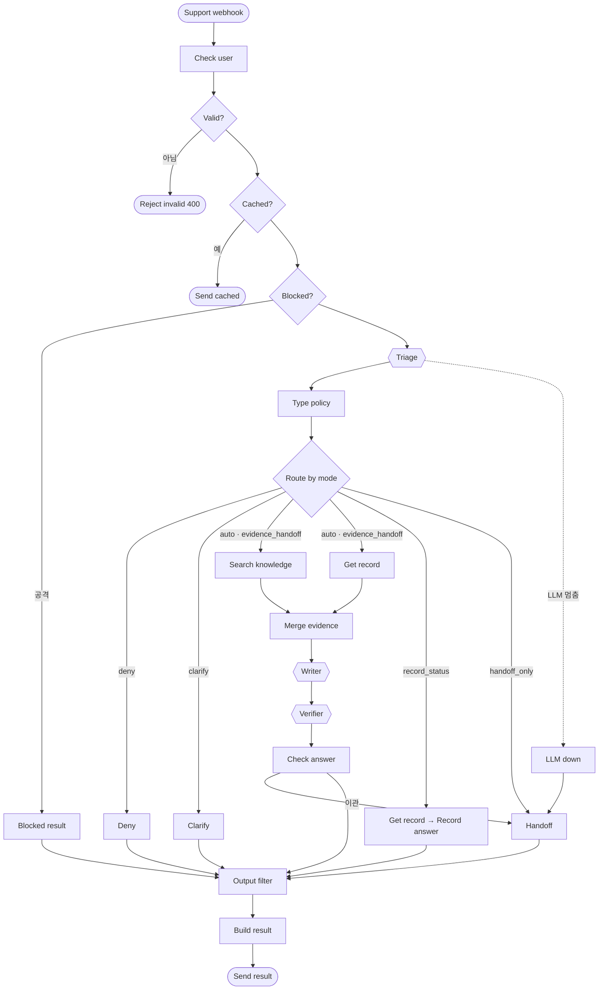

# 노코드 워크플로우 설계서 · 3팀

> 샘 `templates/WORKFLOW-DESIGN-TEMPLATE.md` (원본 요구 KSM-REQ 4절 산출물 1)의 구조입니다. 노드 이름은 `workflows/*.json`의 실제 이름과 같아야 합니다. `<측정 후>` 칸은 `runs/` 보고서에서 옮깁니다. 담당: 1절 리드, 2~4절 오케스트레이션, 5~7절 연동 · 안정성.

## 1. 업무 시나리오

가상 창고형 약국에서 계산대 직원이 마감 순서 · 회수 공표 · 접수 건을 묻거나, 어르신 손님이 약 정보를 물으면 질문하기 화면(또는 팀 웹훅)으로 들어옵니다. 워크플로우는 입력을 검사하고 분류한 뒤, 유형의 처리 방식에 따라 약국 문서를 검색해 근거와 함께 답하거나, 사람이 정할 일(회수 대상 확인 · 현금 차액 · 복약 판단 · 위험 신호)은 당일 책임 약사나 약국장에게 티켓으로 넘깁니다. 기록은 늘 data-api(티켓 · 알림 · DLQ)에 먼저 남고, 약사 화면 · Slack · Jira는 덧붙임입니다.

| 처리할 문의 유형 | 처리 방식 | 근거 문서 | 긴급도 기준 |
| --- | --- | --- | --- |
| 회수 공지가 떴어요 (`recall`) | 근거 + 이관 (약사) | `recall-first-response`, `recall-customer-guide` | 늘 `high` |
| 혼자 하는 첫 마감 (`closing`) | 자동 답변 / 차액 → 근거 + 이관 (약국장) | `closing-checklist`, `closing-cash-mismatch` | 냉장고 · 온도 · 향정 · 도난 → `high` (약사) |
| 어르신 약 질문 (`senior`) | 자동 답변 + AI 고지 / 병용 · 내 경우 → 보완 질문 뒤 이관 | `senior-*` 3개 | 숨참 · 가슴 · 의식 · 출혈 · 임신 등 → `high` |
| 내 접수 건 확인 (`record_status`) | 접수 조회 | `request-records-guide` | — |

## 2. 전체 흐름

1. 문의 수신 (Webhook `team3-support`, Header Auth)
2. 사용자 확인 (`GET /employees/<user>` → `role` · `access_levels`)
3. 입력 검증 (빈 질문 · 501자 · 없는 사용자 → 400, LLM 호출 없음)
4. 중복 확인 (`/cache/<request_id>`, 같은 요청이면 저장된 결과)
5. 주입 차단 (규칙, LLM 앞)
6. 분류 Agent (`Triage`) → `Type policy` (역할 · `handoff_rules` · 보완 질문 · 접수 번호)
7. 처리 방식으로 분기 (`Route by mode`: 자동 답변 · 근거 + 이관 · 이관만 · 접수 조회 + 권한 없음 · 보완 질문)
8. 병렬: 지식 검색 (`team3-search`, 권한별 메모리 키) + 접수 조회 (`requester = user`)
9. 답변 Agent (`Writer`) → 검증 Agent (`Verifier`) + 금지 문장 검사 (`Check answer`)
10. 이관 (`team3-handoff`: data-api 티켓 · 알림 · DLQ 먼저 → 화면 · Slack · Jira 덧붙임)
11. 출력 필터 (연락처 가림) → 응답 조립 · 캐시 저장 · 실행 기록 (개인정보 없이) → Respond

## 3. 워크플로우 흐름도

워크플로우 파일:

| 파일 | 웹훅 · 트리거 | 맡은 사람 | 노드 수 |
| --- | --- | --- | --- |
| `team3-support.json` | `POST /webhook/team3-support` | 다영 | 47 |
| `team3-index.json` · `team3-search.json` | `team3-index` · `team3-search` | 영민 | 15 · 13 |
| `team3-handoff.json` · `team3-errors.json` | `team3-handoff` · Error Trigger (`team3Errors00001`) | 병훈 | 31 · 11 |
| `team3-ticket.json` · `team3-alert.json` | Execute Workflow (`team3Ticket00001` · `team3Alert000001`) | 태웅 | 7 · 7 |

## 4. 에이전트 역할 · 분기 · 병렬 · 루프

### 4.1 역할 카드

| 역할 | 목적 | 입력 | 출력 (JSON) | Tool | 하지 않는 것 | 노드 이름 |
| --- | --- | --- | --- | --- | --- | --- |
| 분류 (triage) | 유형 · 긴급도 · 모자란 정보 | 질문 · 보완 답 · 역할 | `{type, urgency, missing, ticket_id}` | 없음 | 답하지 않음 | `Triage` |
| 답변 (writer) | 번호 붙은 발췌로만 답 | 질문 · 발췌 · 접수 상태 | 글 + `[n]` | 없음 | 발췌 밖 내용, 복용 판단, 약속 | `Writer` |
| 검증 (verifier) | 근거 · 정책 확인 | 질문 · 답 · 발췌 | `{grounded, policy_ok, issues}` | 없음 | 답을 새로 쓰지 않음 | `Verifier` |

### 4.2 구조

| 구조 | 어디 (노드) | 목적 | 기준값 · 최대 횟수 | 확인한 시나리오 |
| --- | --- | --- | --- | --- |
| 분기 | `Route by mode` | 처리 방식 4개 + 권한 없음 · 보완 질문 | `Type policy` 표 | WF-01 · 02 · 05 · 06 · 12 |
| 분기 | `Build context` → `Evidence?` → `Check answer` | 검색 점수 · 근거 유무 · 금지 문장 | `SCORE_MIN` = 0.37 (영민 실측), `top_k` = 4 | WF-03, T-33 |
| 병렬 | `Search knowledge` + `Get record` → `Merge evidence` | 근거와 접수 상태를 서로 기다리지 않고 | — (잰 시간: <측정 후>) | WF-12 |
| 루프 | `attempt` (요청 사이) | 보완 질문 | 최대 3회 (3회째 이관) | WF-02 · 02b, T-32 · 33 |
| 외부 호출 | HTTP 재시도 없음 | 본체의 HTTP Request 7개 (`Check user` · `Check cache` · `Search knowledge` · `Get record` · `Handoff` · `Save cache` · `Log request`) | 각 호출은 설정된 timeout 뒤 오류 갈래로 진행. `Get record`의 4초 제한은 전체 6초 응답 목표를 위한 값. 티켓 생성 재시도는 별도 `team3-handoff` 계약 (`00-DESIGN.md` 3.4절) | WF-04 · 11 |

## 5. 외부 연동 노드

| 노드 | 연동 대상 (연습용 → 실제 운영) | 인증 | 입력 | 출력 | 오류 처리 |
| --- | --- | --- | --- | --- | --- |
| `Support webhook` | 팀 Webhook → 웹 화면 · Slack Trigger | Header Auth (`team3WebhookKey`) → SSO · Slack 서명 | 계약 요청 | — | 401 (n8n) |
| `Create ticket` | data-api `POST /tickets` → (약사 이관은 우리 화면, 장애만 Jira) | 77판은 키 없음 → 80판은 `dataApiKey` (`X-Api-Key`) | `{key, title, requester, category, priority}` | `{ticket_id, duplicate}` | 1차 실패 뒤 5xx·timeout·429만 2회 더 재시도 (2초 timeout · 500ms 간격, 최악 7초 < 본체 8초) → DLQ + 알림. 401·403은 재시도 없이 `auth_failed` |
| `Send DLQ` | data-api `POST /dlq` | 위와 같음 | `{item:{id, type, priority, reason, severity}}` | `{ok}` | 실패 무시, `dlq: true` |
| `Send alert` | data-api `POST /alerts` → Slack `#support-alerts` | 위와 같음 | `{workflow, severity, reason, message}` | `{stored}` | 실패 무시, `alert` 플래그만 (중복 티켓은 알림 없음) |
| `Post to screen` | FastAPI `POST /tickets` (약사 화면, data-api 티켓이 있을 때만) | `team3ApiKey` (`X-Api-Key`) | data-api와 같은 본문 + `ticket_id` · `product` | 201 / 200 | 2초 timeout, 실패 무시 → `extras.screen: "failed"` |
| `Call Slack` | `team3-alert` (`team3Alert000001`) → Slack | Slack Bot (`slackAio3Bot0001`) | `{mode, severity, reason, message}` | `{ok, mode, error}` | 실패 무시 → `extras.slack: "failed"` |
| `Call Jira` | `team3-ticket` (`team3Ticket00001`) → Jira | Jira Cloud (`jiraAio3Cloud001`) | `{mode, summary, reason}` | `{ok, mode, error}` | 실패 무시 → `extras.jira: "failed"` |
| `Get record` | data-api `GET /tickets/<id>?requester=` → 약국 접수 시스템 | `X-Api-Key` → 사내 API | 번호 · 사용자 | 접수 건 / 403 | timeout 4초, 재시도 없음 → 이관 (`tickets_slow`) |
| `Check user` | data-api `GET /employees/<user>` → 약국 계정 · SSO | `X-Api-Key` | 이름 | `role` · `access_levels` | 404 → 400 `unknown_user` |

## 6. 노드 간 페이로드 (연결선마다)

예시 원본은 [`../contracts/examples/`](../contracts/examples/) (실행 뒤에는 실제 실행에서 복사하고 개인정보를 가림).

| 연결선 | 필수 필드 | 선택 필드 | 변환 로직 | 예시 |
| --- | --- | --- | --- | --- |
| Webhook → `Validate input` | `request_id`, `user`, `question` | `channel`, `attempt`, `context` | 공백 · 마크다운 제거 | `support.json` `request` |
| `Type policy` → `Search knowledge` | `query`, `access_levels` | `top_k`, `type` | 역할 → 메모리 키 | `search.json` `request` |
| `Search knowledge` → `Merge evidence` | `evidence[]` | `search_ms` | `SCORE_MIN` 미만 · 중복 제거 | `search.json` `response` |
| `Check answer` → `Handoff` | `request_id`, `user`, `type`, `title`, `assignee`, `priority`, `reason` | `summary`, `product` | 질문 요약 80자, 연락처 가림 | `handoff.json` `request` |
| `Handoff` → `Build response` | `ticket`, `reason`, `dlq`, `alert` | `extras` | — | `handoff.json` `response_ok` |
| `Handoff` → data-api `/dlq` | `item.id`(= `request_id`), `item.type`, `item.priority`, `item.reason`, `item.severity` | — | 연락처 · 약 이름 + 손님 조합은 넣지 않음 | `handoff.json` `response_tickets_down` |
| `Handoff` → data-api `/alerts` | `workflow`, `node`, `severity`, `reason`, `message` | `ticket_id` | 메시지는 유형 · 담당자만 (연락처 없음) | `handoff.json` `response_ok` |
| `Error Trigger` → `/alerts` · `/dlq` | `workflow`, `node`, `message`(앞 200자), `execution_id`, `severity:"critical"`, `reason:"unexpected"` | — | 메시지 연락처 가림 | — |

## 7. 오류 처리

| 상황 | 알아채는 노드 | 처리 | 사용자 응답 | 기록 | 확인한 시나리오 |
| --- | --- | --- | --- | --- | --- |
| 인증 실패 | `Create ticket` · HTTP 401/403 | 재시도 없이 DLQ + 알림 (`reason: auth_failed`) | 이관 안내 | DLQ · 알림 | 팀 |
| 호출 한도 (429) | `Create ticket` HTTP 상태 | 5xx·timeout·429만 1+2회 재시도 (2초 timeout · 500ms 간격) 뒤 DLQ + 알림 | 이관 안내 | 재시도 수 · DLQ | 팀 |
| 검색 결과 없음 | `Evidence?` | 이관 `no_evidence` | 담당자 연결 안내 | `reason` | WF-03 |
| 외부 API 장애 (5xx · timeout) | `Create ticket` | 1+2회 재시도 → DLQ + 알림 | 200, `ticket: null`, `dlq: true` | DLQ · 알림 | WF-04 |
| 중복 요청 | `Cached?` · `Create ticket`의 `key` | 저장된 결과 / 기존 티켓, `duplicate: true` | 같은 답 | — | WF-09 |
| LLM 멈춤 | Agent 오류 출력 → `LLM down` | 이관 (자동 답변 없음) | 이관 안내 | `llm_down` | WF-10 |
| 접수 조회 느림 | `Get record` timeout 4초 | 티켓 없이 바로 답 | 6초 안 | `tickets_slow` | WF-11 |
| 화면 · Slack · Jira 실패 | `Post to screen` · `Call Slack` · `Call Jira` | 실패 무시, `extras`에 `failed`만 | 정상 응답 | `extras` | WF-04 · 12 |
| 예상 못 한 오류 | Error Trigger (`team3Errors00001`) | `/alerts` critical + `/dlq` (+ real이면 Jira) | — | 알림 · DLQ | 팀 |

Error Workflow: `team3-errors` (`team3Errors00001`) — push·게시 뒤 웹훅 500에서 2~3초 안에 실행되는지 확인 (`flow.py ops`). 모든 워크플로우 `settings.errorWorkflow`에 연결.

## 8. 64~79일차에서 가져온 것

| 가져온 것 (일차 · 파일) | 어디에 | 바꾼 것 |
| --- | --- | --- |
| 72 `reference/baseline-helpdesk.json` | `team3-support` 뼈대 | 팀 계약에 맞춰 `Support settings` · `Type policy` · 처리 방식 분기 · 검색/접수 조회 병렬 갈래 · 이관 · 캐시를 연결한 47노드 본체로 확장 |
| 73 입력 검사 · 본인 건 · 출력 필터 | `Validate input` · `Get record` · `Output filter` | 사용자 조회와 입력 오류를 LLM 앞에서 검사하고, 접수 조회에 `requester`를 넣어 본인 건만 확인하며, 응답의 연락처를 가림 |
| 71 `lab01-example2-index` · `-search` | `team3-index` · `team3-search` | 권한별 메모리 키 2개 |
| 76 `lab02-example2-intake` · `-error-handler` | `team3-handoff` · `team3-errors` | data-api 먼저 + 덧붙임 |
